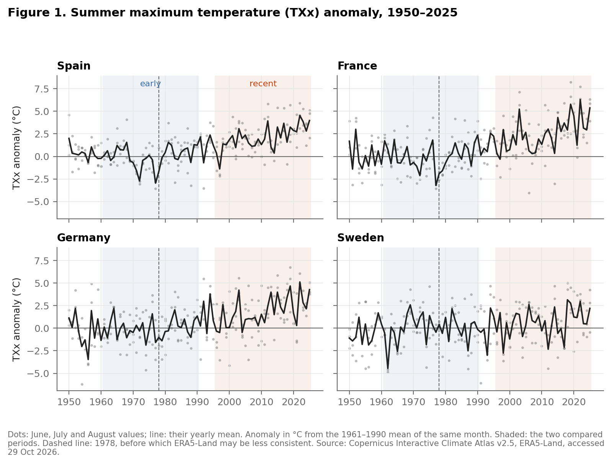
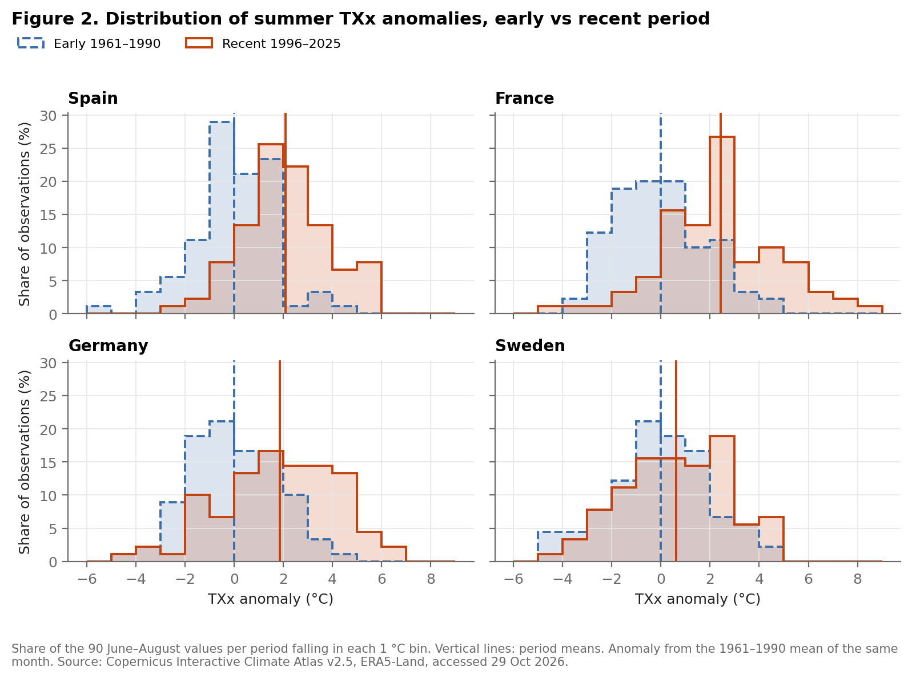
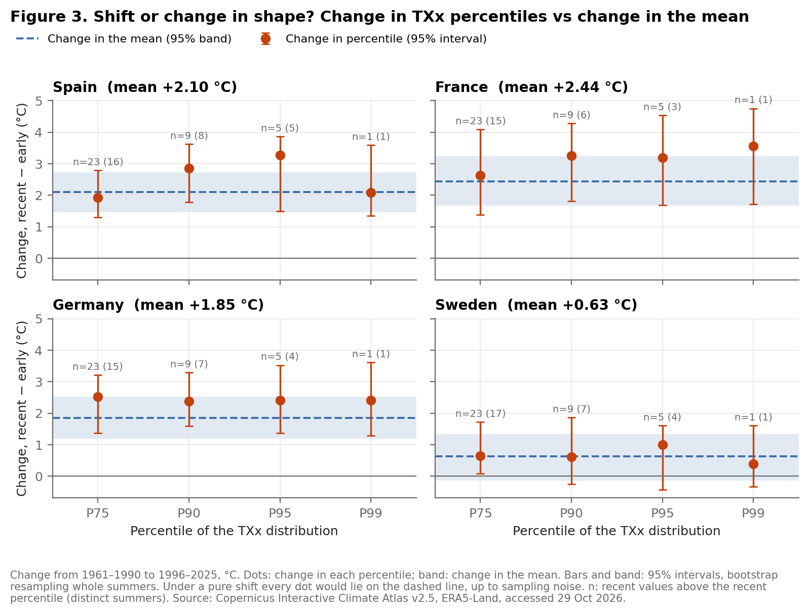
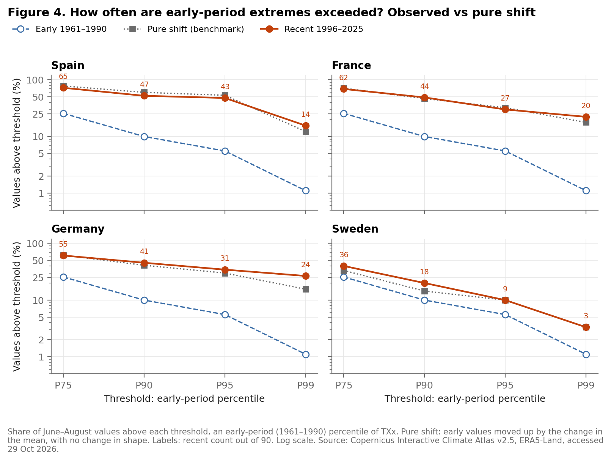
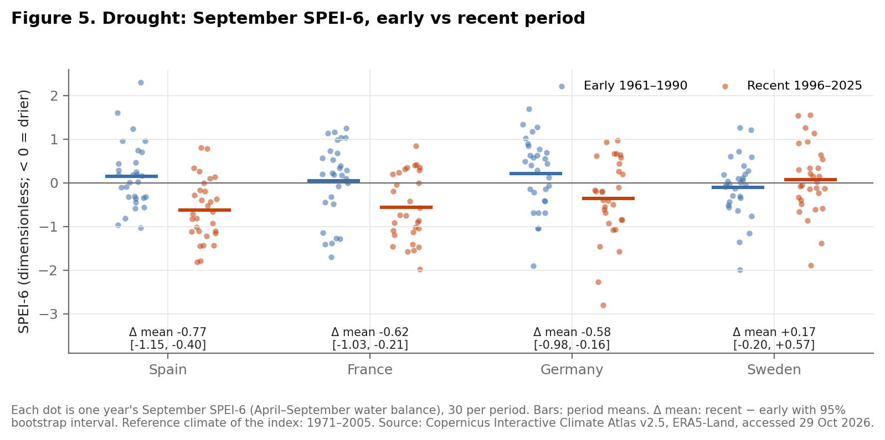

# 4. Figures

All figures are produced by `python scripts/figures.py` from the outputs of
`scripts/analysis.py`. Numbers quoted below come from `outputs/shift_shape.csv`
and `outputs/exceedance.csv`.

**Figure 1.** Summer TXx has risen since the 1980s in Spain, France and Germany;
in Sweden the rise is small relative to year-to-year variation.

The figure places the two compared periods in the full 1950–2025 record. The
year-to-year spread (several °C) is of the same order as the change between
periods, which is why the rest of the section compares whole distributions
rather than single years. The dashed line marks 1978: ERA5-Land may be less
consistent before that year, which affects about half of the early period.

**Figure 2.** In Spain, France and Germany the recent distribution of summer TXx
lies to the right of the early one over its whole range, not only in its upper
tail.

Each panel compares the 90 June–August anomalies of each period. The recent
distribution is displaced as a whole; in France and Germany it is also somewhat
wider. In Sweden the two distributions largely overlap.

**Figure 3.** In all four countries the upper percentiles of TXx moved by about
as much as the mean: the data are consistent with a shift of the whole
distribution, with no clear change in the shape of its tail.

This is the central figure. Under a pure shift every percentile would move by
exactly the change in the mean. The P95 moved somewhat more than the mean in
every country (for example +3.28 °C against +2.10 °C in Spain), but the
difference between the two has a 95% interval that includes zero in all four
countries. The upper tail rests on few observations: the recent values above
the P95 come from only 3 to 5 distinct summers, so a tail change of moderate
size could not be detected with these data.

**Figure 4.** Whatever threshold defines an extreme, the recent frequency of
exceedances is close to what a pure shift of the early distribution predicts.

By construction 5% of early values (5 of 90) exceed the early P95. In the
recent period this rises to 43 in Spain, 27 in France, 31 in Germany and 9 in
Sweden. Exceedances multiply most at the highest thresholds even under a pure
shift, because a shift moves many values across a threshold that few values
reach. The observed counts track that benchmark closely; the largest gap is
Germany at the P99, with 24 exceedances against 14 under a pure shift, a gap
that rests on few events (from 15 summers).

**Figure 5.** Late-summer drought conditions (SPEI-6) have become drier on average
in Spain, France and Germany, with no clear change in Sweden.

The change in mean SPEI-6 is −0.77 in Spain, −0.62 in France and −0.58 in
Germany, with 95% intervals that exclude zero, and +0.17 in Sweden, with an
interval that includes zero. With 30 values per period, only about two lie below
the P5, so the data cannot say whether the drought tail changed shape.
